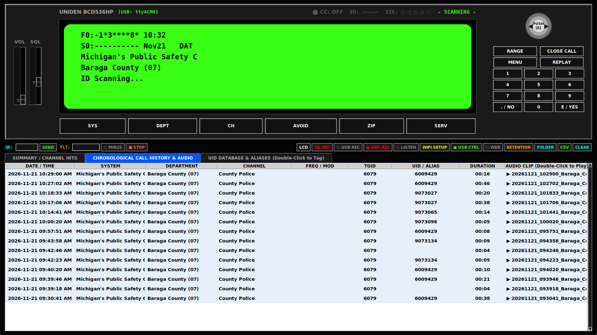

# LinScan-536

A lightweight, native Linux control panel, activity logger, UID alias manager, and USB/Wi-Fi audio recorder for Uniden BCD536HP and SDS200 digital scanners.



## What's New

- **USB-First Control & Live Switching:** Defaults to USB serial (`● USB CTRL`) and switches safely to Wi-Fi UDP (`● WIFI CTRL`) with a live badge (`[USB: ttyACM0]` / `[WIFI: IP]`).
- **Upgraded Wi-Fi UDP & RTSP Audio:** Built-in `WIFI SETUP` test (`Test Wi-Fi`), UFW-friendly ports (`50538-50539`), clean `TEARDOWN`, auto-reconnect, and a 0.5s pre-roll buffer.
- **Live Wi-Fi Speaker Monitor (`LISTEN`):** Stream real-time scanner audio over Wi-Fi via `ffplay` with or without recording MP3s.
- **Persistent SQLite History & 3 Tabs:** Saves logged calls across restarts (`~/.config/linscan/history.db`) across **Summary / Channel Hits**, **Chronological Call History & Audio** (double-click to play, `■ STOP` to halt), and **UID Database & Aliases** (double-click to tag with live cross-tab sync).
- **Sorting, Live Search & Kerchunk Filter:** Click any column header to sort, type in `FLT:` to filter live, and toggle `MIN2S` to skip calls under 2 seconds.
- **Interactive LAN Web Server (`WEB`):** View live LCD and history in any browser on your local network with remote keypad controls.

## Installation (Debian / Ubuntu / Mint / BunsenLabs)

Requires `python3`, `python3-tk`, `python3-serial`, and `ffmpeg` (includes `ffplay`).

```bash
git clone https://github.com/UPMI-Scanner/LinScan-536.git
cd LinScan-536
./install.sh
```

Or run directly from the project folder:

```bash
python3 linscan_536.py
```

## Hardware & Wi-Fi Setup

- **USB Serial (Default):** Plug a data-capable Mini-USB cable into the front port of the BCD536HP and press `. / NO` for **Serial Port** mode.
- **USB Audio Recording (`USB REC`):** Connect a 3.5mm audio cable from the scanner to your PC audio input.
- **Optional Wi-Fi Control & Audio:** Recommended BC-WF1 firmware is **v7.28**. Click **WIFI SETUP**, enter your scanner IP, and click **Test Wi-Fi**. If using `ufw`, allow your scanner IP:

```bash
sudo ufw allow from SCANNER_IP port 50536 proto udp
sudo ufw allow from SCANNER_IP proto udp to any port 50538:50539
```

## Disclaimer & License

Independent open-source project; not affiliated with or endorsed by Uniden.
Distributed under the **MIT License**.
